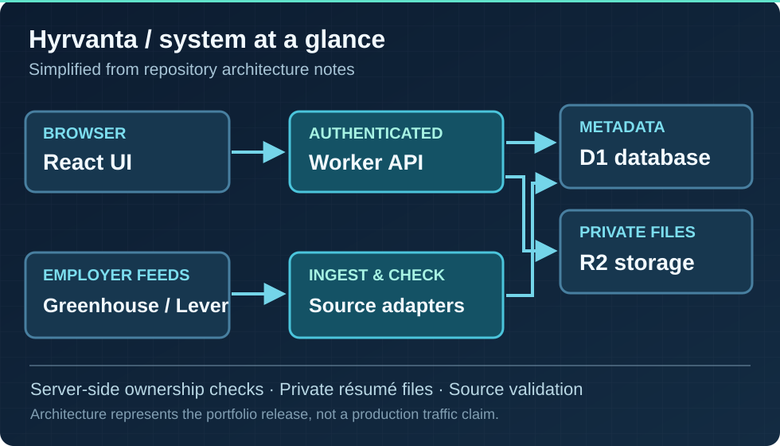
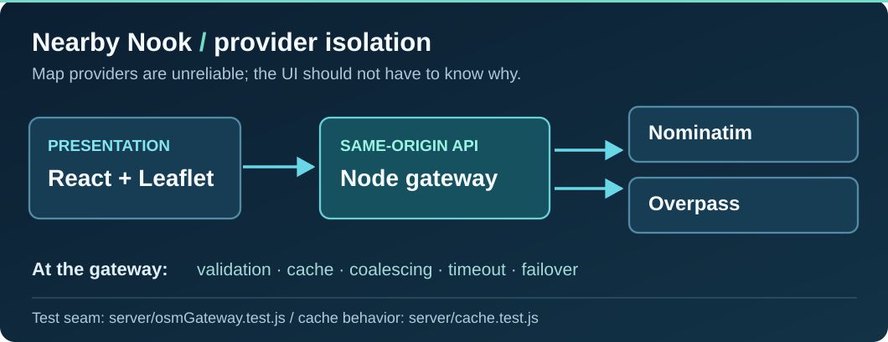

 

<strong>IT Support Specialist at Atos &nbsp;·&nbsp; Full-Stack Developer &nbsp;·&nbsp; Founder, AILEVATED</strong>

From diagnosing user-facing incidents to designing APIs, I enjoy understanding <em>why systems behave the way they do</em>—and making them work better.

Manila, Philippines &nbsp; / &nbsp; Interested in software engineering, backend, and cloud roles

---

## Hello, I'm Randy.

I work in technical support and build full-stack applications. The overlap has shaped how I approach software: understand the user's problem, trace it through the system, decide where trust belongs, and explain failures clearly.

I'm developing toward a career in software engineering—particularly **backend services, cloud infrastructure, and products that need to be dependable in everyday use**.

Rather than listing every tool I've touched, I want the work to speak for itself.

### Pick a path through my work

| If you're looking for… | Start here |
|:--|:--|
| **Product thinking and end-to-end delivery** | [Hyrvanta](#01--hyrvanta--career-intelligence) and [JobPilot](#04--jobpilot--ai-career-workspace) |
| **Backend/API fundamentals** | [Storefront Admin](#03--storefront-admin--inventory-operations) |
| **Integration reliability and failure handling** | [Nearby Nook](#02--nearby-nook--local-discovery) |
| **A deeper technical review** | [Engineering notes with code references](./docs/engineering-notes.md) |

---

## Selected work

### 01 · Hyrvanta — career intelligence

**React 19 · TypeScript · Cloudflare Workers · D1 · R2**

**The question:** How can a career platform recommend next steps without inventing job evidence or exposing someone’s résumé?

I built a workspace for job discovery, application tracking and career evidence. The important work happens behind the interface:

- **Ownership:** authenticated API routes use the user's identity to scope records.
- **Data:** D1 stores application and Career Vault metadata; private R2 stores résumé files.
- **Integrations:** Greenhouse and Lever adapters normalize job records and apply source, URL and freshness rules.
- **Verification:** domain and route tests, React UI checks, typechecking and rendered-output tests are defined in the repository.

**Architecture — the boundaries that matter**

The user interface is not the authority for access control. The API owns authorization, and files are kept separate from the public application assets.

**Inspect:** [Repository](https://github.com/ailevated-randy-alonzo/hyrvanta-career-intelligence) · [API implementation](https://github.com/ailevated-randy-alonzo/hyrvanta-career-intelligence/blob/main/app/api/jobs/route.ts) · [Job adapters](https://github.com/ailevated-randy-alonzo/hyrvanta-career-intelligence/blob/main/lib/job-sources.ts) · [Security notes](https://github.com/ailevated-randy-alonzo/hyrvanta-career-intelligence/blob/main/docs/security.md) · [Tests](https://github.com/ailevated-randy-alonzo/hyrvanta-career-intelligence/tree/main/tests)

Release note: portfolio-ready working release. Production identity, real employer-source setup, extension pairing and monitoring still require additional configuration or development. Preview vacancies are labeled rather than presented as live.

---

### 02 · Nearby Nook — local discovery

**React · Node.js · Leaflet · OpenStreetMap**

**The question:** What should a location app do when its data provider is slow, incomplete or unavailable?

The answer is not to invent a nearby place. I used a same-origin Node API to isolate OpenStreetMap providers from the React interface.

A testable gateway handles **input validation, TTL caching, request coalescing, upstream timeouts and Overpass fallback**. Development fixtures are clearly separated from live production data.

**Inspect:** [Repository](https://github.com/ailevated-randy-alonzo/nearby-nook-local-discovery) · [Gateway code](https://github.com/ailevated-randy-alonzo/nearby-nook-local-discovery/blob/main/server/osmGateway.js) · [Caching](https://github.com/ailevated-randy-alonzo/nearby-nook-local-discovery/blob/main/server/cache.js) · [Gateway tests](https://github.com/ailevated-randy-alonzo/nearby-nook-local-discovery/blob/main/server/osmGateway.test.js)

---

<table>
<tr>
<td width="50%" valign="top">

<h3>03 · Storefront Admin — inventory operations</h3>

<b>Node.js · Express · MySQL</b>

Inventory CRUD with searchable products, stock views and protected administrator operations. The API handles validation, bcrypt password checks and signed, expiring sessions.

<a href="https://github.com/ailevated-randy-alonzo/fullstack-ecommerce-dashboard"><b>Repository</b></a> · <a href="https://github.com/ailevated-randy-alonzo/fullstack-ecommerce-dashboard/blob/main/server.js">Backend source</a> · <a href="https://github.com/ailevated-randy-alonzo/fullstack-ecommerce-dashboard#api-routes">API routes</a>

</td>
<td width="50%" valign="top">

<h3>04 · JobPilot — AI career workspace</h3>

<b>React · TypeScript · Cloudflare · OpenAI API</b>

Application and private résumé management with evidence-backed role comparisons. AI requests stay server-side, with structured outputs and resource ownership checks.

<a href="https://github.com/ailevated-randy-alonzo/jobpilot-career-copilot"><b>Repository</b></a> · <a href="https://github.com/ailevated-randy-alonzo/jobpilot-career-copilot/tree/main/app/api">API routes</a> · <a href="https://github.com/ailevated-randy-alonzo/jobpilot-career-copilot/tree/main/docs/screenshots">Product tour</a>

</td>
</tr>
</table>

Project screenshots are sourced from their repositories. JobPilot's hosted workspace requires authorized access; a local demonstration path is described in its README.

**More projects:** [Personal portfolio](https://github.com/ailevated-randy-alonzo/randy-alonzo-portfolio) · [AILEVATED AI platform](https://github.com/ailevated-randy-alonzo/ailevated-ai-platform)

---

## What the code shows

| Engineering concern | Example you can inspect |
|:--|:--|
| **Authorization** | [Hyrvanta's authenticated D1 queries and owner-scoped data](https://github.com/ailevated-randy-alonzo/hyrvanta-career-intelligence/blob/main/app/api/jobs/route.ts) |
| **Unreliable dependencies** | [Nearby Nook's upstream timeouts and provider fallback](https://github.com/ailevated-randy-alonzo/nearby-nook-local-discovery/blob/main/server/osmGateway.js) |
| **Cache behavior** | [Nearby Nook's TTL + in-flight request coalescing](https://github.com/ailevated-randy-alonzo/nearby-nook-local-discovery/blob/main/server/cache.js) |
| **Backend fundamentals** | [Storefront Admin's API validation and signed sessions](https://github.com/ailevated-randy-alonzo/fullstack-ecommerce-dashboard/blob/main/server.js) |
| **Testing** | [Hyrvanta's test scripts](https://github.com/ailevated-randy-alonzo/hyrvanta-career-intelligence/blob/main/package.json) and [Nearby Nook's test suite](https://github.com/ailevated-randy-alonzo/nearby-nook-local-discovery/blob/main/server/osmGateway.test.js) |

[**Read the engineering notes →**](./docs/engineering-notes.md) — a closer look at implementation boundaries, code paths, tradeoffs and work that remains before production use.

## Technologies I use

<table>
<tr>
<td width="50%" valign="top">
<b>Software</b>

TypeScript · JavaScript · React · Node.js · Express · REST APIs · HTML/CSS

</td>
<td width="50%" valign="top">
<b>Cloud and data</b>

Cloudflare Workers · D1 · R2 · MySQL · SQL · Drizzle ORM

</td>
</tr>
<tr>
<td width="50%" valign="top">
<b>Engineering practices</b>

Git · GitHub · Vitest · typechecking · ESLint · validation · authorization

</td>
<td width="50%" valign="top">
<b>IT operations</b>

Windows · Microsoft 365 · network troubleshooting · incident documentation

</td>
</tr>
</table>

Experience depth varies by tool. I would rather link to working code than claim expertise that a repository cannot demonstrate.

## Background

**Atos — IT Support Specialist**  
First-line troubleshooting, issue triage, escalation and documentation.

**Technological University of the Philippines–Manila — B.S. Information Technology**  
Coursework and academic work in software, networks and systems.

**AILEVATED — Founder**  
Technology education, AI productivity workflows and software projects.

I am interested in engineering teams where **technical fundamentals, thoughtful design, code review and operational discipline** matter. My support background makes me especially interested in the connection between building systems and keeping them usable.

---

## Get in touch

<b>Have an engineering role, collaboration or a product problem in mind?</b>

<a href="https://portfolio.randyalonzo101.workers.dev">Portfolio</a> &nbsp;·&nbsp; <a href="https://www.linkedin.com/in/randy-m-alonzo/">LinkedIn</a> &nbsp;·&nbsp; <a href="mailto:randyalonzo101@gmail.com">Email</a>

| Professional | Community & freelance |
|:--|:--|
| [Email — randyalonzo101@gmail.com](mailto:randyalonzo101@gmail.com) | [AWS Builder — badges](https://builder.aws.com/community/@ranbyruz?tab=badges) |
| [Personal portfolio](https://portfolio.randyalonzo101.workers.dev) | [Fiverr — AILEVATED](https://www.fiverr.com/sellers/ailevated/) |
| [LinkedIn](https://www.linkedin.com/in/randy-m-alonzo/) | [Upwork — freelancer profile](https://www.upwork.com/freelancers/~01e817b1de0c60f604?viewMode=1&mp_source=share) |
| [GitHub](https://github.com/ailevated-randy-alonzo) | [AILEVATED](https://ailevated.tech) · [YouTube](https://www.youtube.com/@ailevated) |

Thanks for exploring my work. The best engineering conversations start with a question.

