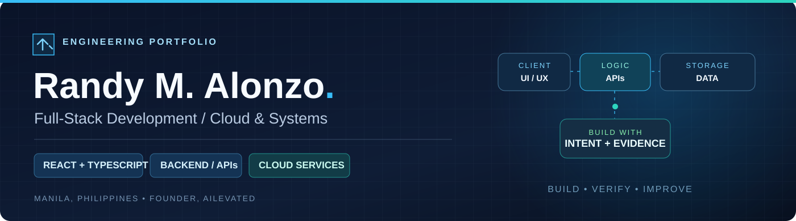
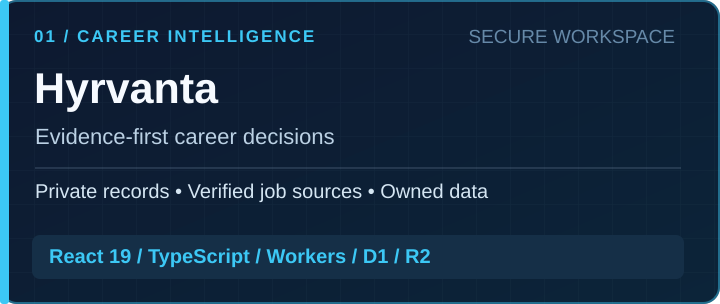
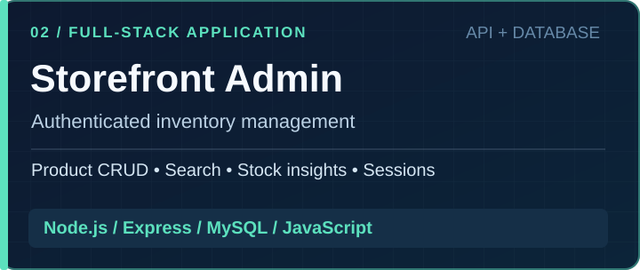
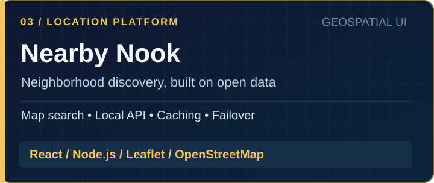
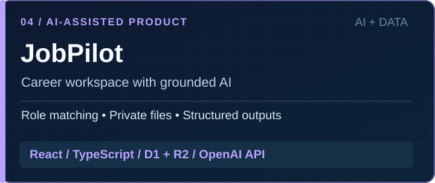

### Engineering-minded developer. Real problems. Thoughtful solutions.

I design and build practical web products—from accessible interfaces and backend APIs to data models, authorization, and cloud services.

  
  
  

**Full-Stack Developer** · **IT Support Specialist at Atos** · **Founder, AILEVATED**  
📍 Metro Manila, Philippines · Open to engineering opportunities and collaborations

---

## 👋 Hi, I'm Randy.

I'm a developer and IT support professional pursuing a **B.S. in Information Technology at the Technological University of the Philippines–Manila**.

My technical-support background influences how I build software: start with the user's problem, make failure states understandable, protect data, document decisions, and improve through testing.

**What I focus on:** full-stack product engineering, backend and API design, cloud-native applications, and systems-oriented problem solving.

<table>
<tr>
<td width="33%" valign="top"><b>01 — BUILD</b> Responsive interfaces, APIs, authentication, and relational data.</td>
<td width="33%" valign="top"><b>02 — VERIFY</b> Input validation, ownership checks, tests, and honest product states.</td>
<td width="33%" valign="top"><b>03 — OPERATE</b> Troubleshooting, clear documentation, and dependable workflows.</td>
</tr>
</table>

## 🏗 Selected engineering projects

**A closer look at the software I've built.** Each repository includes implementation details and instructions; some external integrations or hosted demos require configuration or authorization.

<table>
<tr>
<td width="50%" valign="top">

 <b>Hyrvanta — Career Intelligence</b> 
Privacy-conscious career workspace with verifiable job-source adapters, owner-scoped APIs, and private résumé storage.  
<a href="https://github.com/ailevated-randy-alonzo/hyrvanta-career-intelligence"><b>Code, architecture &amp; setup →</b></a> 
Working portfolio release; hosted integrations require configuration.
</td>
<td width="50%" valign="top">

 <b>Storefront Admin — Inventory Dashboard</b> 
Authenticated inventory CRUD, Express REST APIs, server-side validation, stock insights, and MySQL persistence.  
<a href="https://github.com/ailevated-randy-alonzo/fullstack-ecommerce-dashboard"><b>Code, API routes &amp; screenshots →</b></a>
</td>
</tr>
<tr>
<td width="50%" valign="top">

 <b>Nearby Nook — Local Discovery</b> 
Interactive OpenStreetMap discovery with synchronized maps, local search, server caching, throttling, and provider failover.  
<a href="https://github.com/ailevated-randy-alonzo/nearby-nook-local-discovery"><b>Code, architecture &amp; screenshots →</b></a>
</td>
<td width="50%" valign="top">

 <b>JobPilot — AI Career Copilot</b> 
Application pipeline and evidence-backed role comparison, with private résumé files and server-side structured AI outputs.  
<a href="https://github.com/ailevated-randy-alonzo/jobpilot-career-copilot"><b>Code, product tour &amp; local demo →</b></a> 
Hosted workspace requires authorized access.
</td>
</tr>
</table>

<b>Explore two more projects</b>

- **[Personal Portfolio](https://github.com/ailevated-randy-alonzo/randy-alonzo-portfolio)** — A portfolio connecting real professional experience, technical projects, and ongoing learning. [Live site](https://portfolio.randyalonzo101.workers.dev).
- **[AILEVATED AI Platform](https://github.com/ailevated-randy-alonzo/ailevated-ai-platform)** — A responsive AI-tools, prompts, and learning-resource interface.

## 🧰 Technologies & practical experience

| Domain | Tools and practices |
|:--|:--|
| **Application engineering** | TypeScript, JavaScript, React, HTML/CSS, Node.js, Express |
| **Data & backend** | MySQL, SQL, Cloudflare D1, Drizzle ORM, REST/JSON APIs, private R2 storage |
| **Quality & security** | Vitest, ESLint, input validation, authentication, authorization, owner-scoped access |
| **IT & systems** | Windows, Microsoft 365, network troubleshooting, incident documentation, service desk operations |

Skills reflect project implementation and professional exposure; experience depth varies by technology.

## 🧠 What guides my engineering

- **Solve the underlying problem.** Reproduce issues, understand constraints, and optimize for the people using the product.
- **Design for trust.** Favor explicit ownership checks, transparent uncertainty, private data handling, and grounded AI outputs.
- **Ship work that can be evaluated.** Provide usable source code, project READMEs, architecture notes, realistic screenshots, and clear setup steps.

## 💼 Experience & learning

- **IT Support Specialist — Atos:** First-line support, issue triage, troubleshooting, escalation, and documentation.
- **B.S. Information Technology — Technological University of the Philippines–Manila:** In progress.
- **Founder — AILEVATED:** Hands-on technology learning, practical AI workflows, and original digital resources.

I'm developing toward software engineering, backend/cloud development, and systems-oriented roles.

## 🌐 Contact & professional profiles

| Connect | Link |
|:--|:--|
| ✉️ **Email** | [randyalonzo101@gmail.com](mailto:randyalonzo101@gmail.com) |
| 🌍 **Portfolio** | [portfolio.randyalonzo101.workers.dev](https://portfolio.randyalonzo101.workers.dev) |
| 💼 **LinkedIn** | [Randy M. Alonzo](https://www.linkedin.com/in/randy-m-alonzo/) |
| 🐙 **GitHub** | [@ailevated-randy-alonzo](https://github.com/ailevated-randy-alonzo) |
| ☁️ **AWS Builder badges** | [Community achievements & badges](https://builder.aws.com/community/@ranbyruz?tab=badges) |
| 🎨 **Fiverr** | [AILEVATED seller profile](https://www.fiverr.com/sellers/ailevated/) |
| 💼 **Upwork** | [Freelancer profile](https://www.upwork.com/freelancers/~01e817b1de0c60f604?viewMode=1&mp_source=share) |
| 🚀 **AILEVATED** | [Website](https://ailevated.tech) · [LinkedIn page](https://www.linkedin.com/company/ailevated/) |
| ▶️ **YouTube** | [@ailevated](https://www.youtube.com/@ailevated) |

---

### Have a project, collaboration, or engineering opportunity in mind?

**[Explore my portfolio](https://portfolio.randyalonzo101.workers.dev) · [Connect on LinkedIn](https://www.linkedin.com/in/randy-m-alonzo/) · [Send an email](mailto:randyalonzo101@gmail.com)**

Designed to show the work—not just list the tools. © 2026 Randy M. Alonzo.

