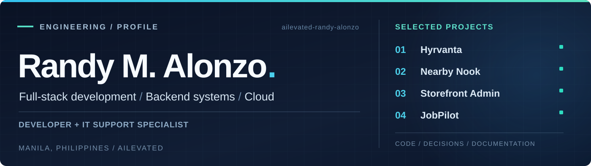

#### Developer · IT Support Specialist at Atos · Founder of AILEVATED

I bring a technical support mindset to software engineering: understand the user, reproduce the issue, protect the data, and make the system easier to operate.

**Manila, Philippines** · Full-stack applications · Backend APIs · Cloud infrastructure

---

## What you'll find here

I build projects around problems I can explain, implement, and test. My focus is **backend software engineering and cloud-based applications**, informed by hands-on experience with technical troubleshooting and incident workflows.

Instead of a long skill list, here are four things you can inspect.

## Selected projects

### [01 · Hyrvanta — private, evidence-first career software](https://github.com/ailevated-randy-alonzo/hyrvanta-career-intelligence)

**The problem.** Job-search applications often mix verified information with assumptions. Résumés are especially sensitive: users need control over private documents and claims about their experience.

**What I built.** A React/TypeScript career workspace with job-source adapters, application tracking, a structured Career Vault, and private résumé versions.

**What matters technically:**

- Authenticated Worker routes check ownership before returning or changing private records.
- Cloudflare D1 stores structured information; private R2 storage handles résumé files.
- Greenhouse and Lever adapters validate, normalize and deduplicate source records.
- The repo contains domain, route, UI and rendered-HTML tests alongside type-checking and lint scripts.

[**Explore source**](https://github.com/ailevated-randy-alonzo/hyrvanta-career-intelligence) · [Architecture](https://github.com/ailevated-randy-alonzo/hyrvanta-career-intelligence/blob/main/docs/current-architecture.md) · [Security model](https://github.com/ailevated-randy-alonzo/hyrvanta-career-intelligence/blob/main/docs/security.md) · [Tests](https://github.com/ailevated-randy-alonzo/hyrvanta-career-intelligence/tree/main/tests)

React 19 · TypeScript · Cloudflare Workers · D1 · R2 · Drizzle ORM · Vitest

#### The architecture at a glance

**Why this design?** UI state isn't an authorization boundary. The server must check who owns each record. Separating D1 metadata from R2 documents also keeps private files out of the public frontend.

Release scope: portfolio-ready working release. Real employer-source setup, production identity, extension pairing and monitoring need additional configuration or work. Preview records are explicitly labeled.

---

### 02–04 · Different problems, different solutions

<table>
<tr>
<td width="45%" valign="top">

</td>
<td valign="top">
<h3><a href="https://github.com/ailevated-randy-alonzo/nearby-nook-local-discovery">Nearby Nook</a></h3>
<strong>React · Node.js · Leaflet</strong>

<b>Problem:</b> Public map providers can return incomplete data or fail.

<b>Approach:</b> Same-origin API with validation, short-lived caching, rate limiting, and Overpass failover. No silent fictional listings.

<a href="https://github.com/ailevated-randy-alonzo/nearby-nook-local-discovery/blob/main/docs/architecture.md">Architecture notes</a> · <a href="https://github.com/ailevated-randy-alonzo/nearby-nook-local-discovery/blob/main/server/osmGateway.test.js">Gateway tests</a>
</td>
</tr>
<tr>
<td width="45%" valign="top">

</td>
<td valign="top">
<h3><a href="https://github.com/ailevated-randy-alonzo/fullstack-ecommerce-dashboard">Storefront Admin</a></h3>
<strong>Node.js · Express · MySQL</strong>

<b>Problem:</b> Inventory updates require predictable writes and protected admin access.

<b>Approach:</b> Product CRUD through a validated REST API, password verification, signed sessions, and stock summaries.

<a href="https://github.com/ailevated-randy-alonzo/fullstack-ecommerce-dashboard/blob/main/server.js">Server implementation</a> · <a href="https://github.com/ailevated-randy-alonzo/fullstack-ecommerce-dashboard#api-routes">API reference</a>
</td>
</tr>
<tr>
<td width="45%" valign="top">

</td>
<td valign="top">
<h3><a href="https://github.com/ailevated-randy-alonzo/jobpilot-career-copilot">JobPilot</a></h3>
<strong>React · TypeScript · Cloudflare</strong>

<b>Problem:</b> AI job advice needs evidence rather than confident-sounding guesses.

<b>Approach:</b> Owner-scoped applications and files, server-side OpenAI Responses API integration, and structured role comparisons.

<a href="https://github.com/ailevated-randy-alonzo/jobpilot-career-copilot">Source &amp; docs</a> · <a href="https://github.com/ailevated-randy-alonzo/jobpilot-career-copilot/tree/main/docs/screenshots">Product walkthrough</a>
</td>
</tr>
</table>

Screenshots above come from each application's repository. JobPilot's hosted workspace requires authorized access; its README explains local demonstration.

**More work:** [Personal portfolio](https://github.com/ailevated-randy-alonzo/randy-alonzo-portfolio) · [AILEVATED AI platform](https://github.com/ailevated-randy-alonzo/ailevated-ai-platform)

---

## Engineering review

These projects have different levels of completeness and testing. Here are the areas where you can verify how I think about implementation:

| Engineering concern | Evidence |
|:--|:--|
| **Authorization & privacy** | [Hyrvanta — server-side ownership checks, private R2 storage](https://github.com/ailevated-randy-alonzo/hyrvanta-career-intelligence/blob/main/docs/security.md) |
| **Dependency failure** | [Nearby Nook — provider timeouts, caching and failover](https://github.com/ailevated-randy-alonzo/nearby-nook-local-discovery/blob/main/docs/architecture.md) |
| **Backend fundamentals** | [Storefront Admin — REST routes and signed sessions](https://github.com/ailevated-randy-alonzo/fullstack-ecommerce-dashboard/blob/main/server.js) |
| **Quality gates** | [Hyrvanta — domain/UI/build checks](https://github.com/ailevated-randy-alonzo/hyrvanta-career-intelligence/blob/main/package.json) · [Nearby Nook — Vitest/build scripts](https://github.com/ailevated-randy-alonzo/nearby-nook-local-discovery/blob/main/package.json) |

<b>What I would improve before operating these projects at scale</b>

- **Hyrvanta:** complete production identity, employer integration and monitoring; harden rate limits and browser-extension pairing.
- **Nearby Nook:** replace process-local cache and rate limits with shared infrastructure for multi-instance operation.
- **Storefront Admin:** add broader API/integration tests and remove demo credentials before any public deployment.
- **JobPilot:** expand end-to-end and accessibility testing; offer an isolated public demo with synthetic data.

I don't equate a portfolio release with a production system that has measured traffic, operational SLAs, or independent security review.

## Technical foundations

| What I work with | Technologies and practices |
|:--|:--|
| **Web applications** | TypeScript, JavaScript, React, HTML/CSS |
| **Backend & data** | Node.js, Express, REST APIs, MySQL, Cloudflare D1, Drizzle ORM |
| **Cloud & storage** | Cloudflare Workers, private R2 object storage |
| **Verification** | Git, GitHub, Vitest, TypeScript checks, ESLint, validation and authorization |
| **IT operations** | Windows, Microsoft 365, network troubleshooting, service desk documentation |

## Experience & education

**IT Support Specialist — Atos**  
First-line troubleshooting, issue triage, escalation and technical documentation.

**B.S. Information Technology — Technological University of the Philippines–Manila**  
Information technology, software and systems education.

**Founder — AILEVATED**  
Practical technology education, software projects, and AI learning resources.

I'm pursuing software engineering opportunities where I can contribute to **backend services, cloud platforms, and reliable user-facing products**—and continue learning alongside experienced engineering teams.

---

## Connect

**Reviewing my work, considering me for an engineering role, or discussing a project?**

[**Portfolio**](https://portfolio.randyalonzo101.workers.dev) &nbsp;·&nbsp; [**LinkedIn**](https://www.linkedin.com/in/randy-m-alonzo/) &nbsp;·&nbsp; [**Email**](mailto:randyalonzo101@gmail.com)

| Professional | Additional work & community |
|:--|:--|
| [✉️ randyalonzo101@gmail.com](mailto:randyalonzo101@gmail.com) | [🎨 Fiverr — AILEVATED](https://www.fiverr.com/sellers/ailevated/) |
| [🌐 Personal portfolio](https://portfolio.randyalonzo101.workers.dev) | [💼 Upwork](https://www.upwork.com/freelancers/~01e817b1de0c60f604?viewMode=1&mp_source=share) |
| [💼 LinkedIn](https://www.linkedin.com/in/randy-m-alonzo/) | [☁️ AWS Builder badges](https://builder.aws.com/community/@ranbyruz?tab=badges) |
| [🐙 GitHub](https://github.com/ailevated-randy-alonzo) | [🚀 AILEVATED](https://ailevated.tech) · [▶ YouTube](https://www.youtube.com/@ailevated) |

Software engineering is more than a demo: understand the boundary, document the tradeoff, and make the implementation inspectable.

