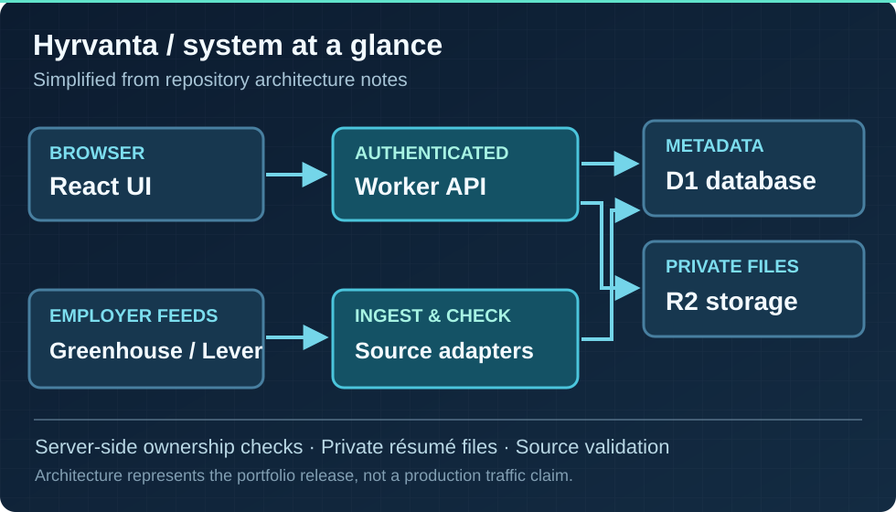
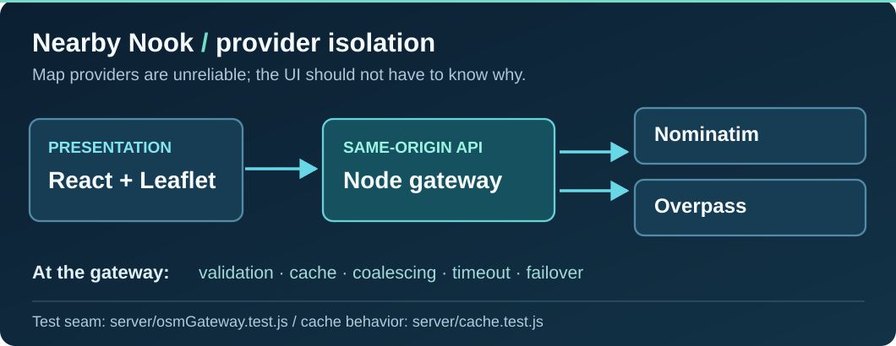

# Engineering notes

A companion to [Randy M. Alonzo's GitHub profile](../README.md).

This is a technical reading guide to my public portfolio projects, not a substitute for the source code. It describes implementation decisions visible in the repositories, how the main components connect, and work that remains before production-grade use.

## 1. Hyrvanta — evidence-first career intelligence

**Repository:** [hyrvanta-career-intelligence](undefined)  
**Problem:** make opportunities and résumé claims traceable while keeping an individual's career data under their control.

### Boundaries

- **Client:** React workspaces and route-based flows for discovery, saved applications, résumés, evidence, and settings.
- **Server API:** authenticated routes own authorization decisions, validation, and persistence.
- **Data:** D1 stores structured application and Career Vault records. R2 stores private résumé objects; file operations are checked server-side.
- **External jobs:** Greenhouse and Lever source adapters normalize incoming records with URL checks, deduplication keys, source metadata, retries and timeouts. An internal sync route is protected separately from user-facing operations.

### Code to inspect

| Focus | Evidence |
| --- | --- |
| Job read/write route with authenticated identity, bound D1 queries and explicit limits | [`app/api/jobs/route.ts`](undefined/blob/main/app/api/jobs/route.ts) |
| Source normalization, timeouts, adapter interfaces and canonical job keys | [`lib/job-sources.ts`](undefined/blob/main/lib/job-sources.ts) |
| Current system structure and implementation boundaries | [`docs/current-architecture.md`](undefined/blob/main/docs/current-architecture.md) |
| Security model and production hardening list | [`docs/security.md`](undefined/blob/main/docs/security.md) |
| Test and build commands | [`package.json`](undefined/blob/main/package.json) · [`tests/`](undefined/tree/main/tests) |

### Design judgment

Separating client state from server-side authorization is intentional: a user's browser is not the authority over who can access a résumé or application. Similarly, a job listing's source and verification status must be represented explicitly rather than inferred from a polished interface.

### Current limitations

This is a portfolio-ready working release with preview data where production services are not configured. Production identity, real employer-board configuration, signed extension pairing, monitoring, rate limiting, secret rotation, CSP review and data-export hardening all need attention before treating it as a public production service. The documentation identifies these boundaries rather than claiming readiness.

## 2. Nearby Nook — graceful behavior around external APIs

**Repository:** [nearby-nook-local-discovery](undefined)  
**Problem:** map data comes from shared public providers that may be incomplete, rate-limited, or temporarily unavailable.

### Boundaries

- **Browser:** React, Leaflet, user search, map state, results and guest-local saved places.
- **Same-origin API:** validates requests and emits stable error responses.
- **OSM gateway:** isolates Nominatim and Overpass; applies request timeouts, provider identification and fallback.
- **Cache:** a TTL cache has capped entries and coalesces concurrent requests for identical keys.
- **Development vs production:** development fixtures are labeled and not silently used to replace live listings in production.

### Code to inspect

| Focus | Evidence |
| --- | --- |
| Upstream timeouts and provider fallback | [`server/osmGateway.js`](undefined/blob/main/server/osmGateway.js) |
| TTL cache, bounded size, request coalescing | [`server/cache.js`](undefined/blob/main/server/cache.js) |
| Gateway behavior tests | [`server/osmGateway.test.js`](undefined/blob/main/server/osmGateway.test.js) |
| Cache tests | [`server/cache.test.js`](undefined/blob/main/server/cache.test.js) |
| System architecture and environments | [`docs/architecture.md`](undefined/blob/main/docs/architecture.md) |

### Design judgment

The frontend is responsible for displaying the truth about what was returned—not for hiding a provider failure or inventing missing ratings or operating hours. The server is a natural boundary for network resilience and usage-policy protection.

### Current limitations

Cache and rate limiting are process-local. A multi-instance deployment would need shared storage and observability, plus better operational metrics. Account synchronization is only foundational; guest behavior is the implemented path.

## 3. Storefront Admin — backend fundamentals

**Repository:** [fullstack-ecommerce-dashboard](undefined)  
**Problem:** inventory operations must validate product data and restrict management actions.

### Design

- **Interface:** responsive product search, editor flows and inventory overview.
- **Backend:** Express routes for login, health and product CRUD.
- **Data:** MySQL connection pool and database schema.
- **Sessions:** bcrypt password verification and a signed HMAC token with an expiration field.
- **Validation:** bounded text fields, non-negative stock and prices, server-side product input checks.

**Code:** [`server.js`](undefined/blob/main/server.js) · [API README](undefined#api-routes) · [schema](undefined/blob/main/schema.sql)

### Current limitations

The repository uses a documented demo administrator and a development-only fallback session secret. These defaults must not be used publicly. More automated integration tests and production configuration checks are also appropriate next steps. The current `check` script is a Node syntax check, not a comprehensive automated test suite.

## 4. JobPilot — AI behind a server boundary

**Repository:** [jobpilot-career-copilot](undefined)  
**Problem:** interview preparation is only useful when generated claims remain grounded in actual résumé information and job descriptions.

### Design

- The workspace manages applications, private résumé versions and analyses.
- Requests for AI comparison execute on the server using the OpenAI Responses API and structured output.
- API resources are scoped to an authenticated user; documents remain in private R2 rather than public frontend assets.
- The hosted experience is access-restricted; a local demo identity is documented.

**Code:** [Project README](undefined) · [`app/api/`](undefined/tree/main/app/api) · [`db/schema.ts`](undefined/blob/main/db/schema.ts) · [`package.json`](undefined/blob/main/package.json)

### Current limitations

Public demo access, broader end-to-end testing and dedicated accessibility testing remain improvements. The repository's test script covers the production build and rendered-page checks; this is not an assertion of comprehensive test coverage.

---

## How to evaluate my work

For an initial review, I would start with Hyrvanta's API boundaries and source adapters, then inspect Nearby Nook's handling of external-service failure. Storefront Admin demonstrates traditional API/database fundamentals; JobPilot demonstrates privacy-aware AI integration.

I avoid claiming traffic, uptime, scaling performance, or security assurance that I have not measured or independently validated. An architecture diagram describes the code's intended connections; it does not prove operational reliability.

**[Back to GitHub profile](../README.md)** · [Portfolio](https://portfolio.randyalonzo101.workers.dev) · [Contact](mailto:randyalonzo101@gmail.com)
